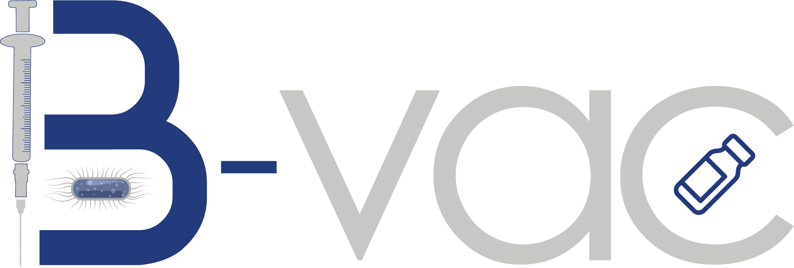
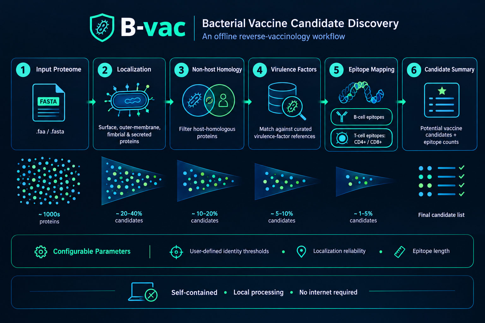

### Reverse Vaccinology. Simplified.

A standalone desktop application for bacterial vaccine candidate discovery.

Screen bacterial proteomes, explore potential vaccine targets, and map epitopes through an intuitive graphical interface.

**No command line. No internet connection. No advanced bioinformatics expertise required.**

<h2></h2>

B-vac is a standalone software package developed to make reverse-vaccinology-based bacterial vaccine design more accessible. It combines protein localization analysis, non-host homology screening, virulence factor identification, and epitope mapping in a single desktop application.

Designed for researchers, students, and laboratory teams, B-vac transforms a bacterial proteome in FASTA format into a filtered set of potential vaccine candidates using adjustable analysis modules and curated reference datasets.

<h2></h2>

| | Feature | Description |
|---|---|---|
| 🎯 | **Subcellular Localization** | Identify proteins associated with relevant cellular locations using reference data from LocTree3. |
| 🧬 | **Non-Host Homology** | Apply non-host homology screening to help prioritize potential vaccine targets. |
| 🛡️ | **Virulence Factor Analysis** | Screen protein sequences against curated virulence factor reference data from VFDB. |
| 📈 | **Epitope Mapping** | Map potential B-cell and T-cell epitopes using reference data from IEDB. |

### Designed for accessibility

- ✅ **Four adjustable filters** to configure the analysis workflow.
- ✅ **Graphical user interface** built with Python and Tkinter.
- ✅ **Offline operation** without requiring an active internet connection.
- ✅ **Standalone executables** for Windows and Linux.
- ✅ **Integrated workflow** for screening and prioritizing candidate proteins.

<h2></h2>

  

B-vac uses a string-based sequence-matching approach against curated reference datasets.

The results support the identification and prioritization of potential vaccine candidates for further investigation.

> *Note: B-vac is a computational screening tool. Predicted candidates require appropriate downstream validation.*

<h2></h2>

| Property | Details |
|---|---|
| **Version** | 1.0 |
| **Category** | Reverse vaccinology · Bacterial vaccine design |
| **Language** | Python 3.10 |
| **Interface** | Tkinter desktop GUI |
| **Platforms** | Windows and Linux |
| **Internet requirement** | Not required |
| **Distribution** | Standalone executable |
| **License** | Apache License 2.0 |

<h2></h2>

Get the standalone application and access the available release information.

🔗 [samavinasir.github.io/b-vac](https://samavinasir.github.io/b-vac/)

<h2></h2>

If you use B-vac in your research, please cite the original publication:

> Ali, A., Hamid, M. H. B., Nasir, S., Ishaq, Z., & Anwer, F. (2025). B-vac: A robust software package for bacterial vaccine design. *Scientific Reports*, **15**, 31745.

**DOI:** [10.1038/s41598-025-01201-0](https://doi.org/10.1038/s41598-025-01201-0)

<h2></h2>

Developed by the **Integrative Biology Laboratory**, Atta-ur-Rahman School of Applied Biosciences (ASAB), National University of Sciences and Technology (NUST), Islamabad, Pakistan.

**Laboratory website:** [mgbio.asab.nust.edu.pk](https://mgbio.asab.nust.edu.pk/)

<h2></h2>

B-vac is released under the [Apache License 2.0](https://www.apache.org/licenses/LICENSE-2.0).

---

**Built for accessible, data-driven vaccine research.**

B-vac · Reverse Vaccinology · NUST Islamabad

