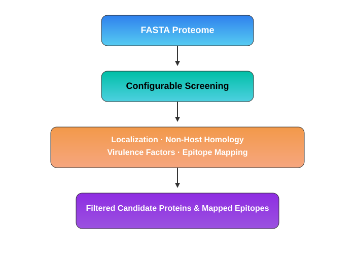

# B-vac

  
  
  
  

  <strong>Reverse Vaccinology. Simplified.</strong>
   
  A standalone desktop application for bacterial vaccine candidate discovery.

  Screen bacterial proteomes, explore potential vaccine targets, and map epitopes through an intuitive graphical interface.
   
  No command line. No internet connection. No advanced bioinformatics expertise required.

  <a href="https://samavinasir.github.io/b-vac/"><strong>Download B-vac →</strong></a>
  &nbsp; · &nbsp;
  <a href="#features">Features</a>
  &nbsp; · &nbsp;
  <a href="#citation">Citation</a>

---

## Overview

B-vac is a standalone software package developed to make reverse-vaccinology-based bacterial vaccine design more accessible. It combines protein localization analysis, non-host homology screening, virulence factor identification, and epitope mapping in a single desktop application.

Designed for researchers, students, and laboratory teams, B-vac transforms a bacterial proteome in FASTA format into a filtered set of potential vaccine candidates using adjustable analysis modules and curated reference datasets.

## Features

<table>
  <tr>
    <td width="50%" valign="top">
      <h3>🔵 Subcellular Localization</h3>
      Identify proteins associated with relevant cellular locations using reference data from LocTree3.
    </td>
    <td width="50%" valign="top">
      <h3>🔴 Non-Host Homology</h3>
      Apply non-host homology screening to help prioritize potential vaccine targets.
    </td>
  </tr>
  <tr>
    <td width="50%" valign="top">
      <h3>🟡 Virulence Factor Analysis</h3>
      Screen protein sequences against curated virulence factor reference data from VFDB.
    </td>
    <td width="50%" valign="top">
      <h3>🟢 Epitope Mapping</h3>
      Map potential B-cell and T-cell epitopes using reference data from IEDB.
    </td>
  </tr>
</table>

### Designed for accessibility

- **Four adjustable filters** to configure the analysis workflow.
- **Graphical user interface** built with Python and Tkinter.
- **Offline operation** without requiring an active internet connection.
- **Standalone executables** for Windows and Linux.
- **Integrated workflow** for screening and prioritizing candidate proteins.

## How It Works

  

B-vac uses a string-based sequence-matching approach against curated reference datasets.  
The results support the identification and prioritization of potential vaccine candidates for further investigation.

*Note: B-vac is a computational screening tool. Predicted candidates require appropriate downstream validation.*

## Software Information

| Property | Details |
|:--|:--|
| Version | 1.0 |
| Category | Reverse vaccinology · Bacterial vaccine design |
| Language | Python 3.10 |
| Interface | Tkinter desktop GUI |
| Platforms | Windows and Linux |
| Internet requirement | Not required |
| Distribution | Standalone executable |
| License | Apache License 2.0 |

## Download

  

  Get the standalone application and access the available release information.
   
  <a href="https://samavinasir.github.io/b-vac/">samavinasir.github.io/b-vac</a>

## Publication

If you use B-vac in your research, please cite the original publication:

Ali, A., Hamid, M. H. B., Nasir, S., Ishaq, Z., & Anwer, F. (2025). B-vac: A robust software package for bacterial vaccine design. *Scientific Reports*, **15**, 31745.

**DOI:** [10.1038/s41598-025-01201-0](https://doi.org/10.1038/s41598-025-01201-0)

## Development Team

Developed by the **Integrative Biology Laboratory**, Atta-ur-Rahman School of Applied Biosciences (ASAB), National University of Sciences and Technology (NUST), Islamabad, Pakistan.

🌐 **Laboratory website:** [mgbio.asab.nust.edu.pk](https://mgbio.asab.nust.edu.pk/)

## License

B-vac is released under the [Apache License 2.0](https://www.apache.org/licenses/LICENSE-2.0).

---

  <strong>Built for accessible, data-driven vaccine research.</strong>
   
  B-vac · Reverse Vaccinology · NUST Islamabad

